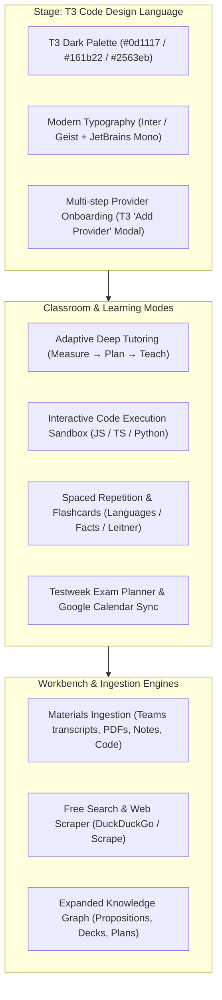

# Learnins — Product & Architecture Blueprint

## 1. Vision & Core Identity

**Learnins** is an agentic, local-first learning environment designed for deep mastery, test preparation, coding practice, and rapid recall. It takes the solid pedagogical core of LearnHarness (Measure → Plan → Teach → Practice with an evolving Knowledge Graph) and rebuilds the presentation layer, onboarding, and tool ecosystem to match the sleek, distraction-free aesthetic of **T3 Code**.

---

## 2. System Architecture & Pillars

---

## 3. Detailed Feature Specifications

### 3.1. Pillar 1: T3 Code UI & Typography Overhaul
- **Fonts**:
  - Replace the CMU Serif / Source Sans 3 pairing with **Inter** or **Geist** for crisp, modern sans prose and UI chrome.
  - Retain **JetBrains Mono** for code, math tokens, statistics, and terminal displays.
  - Eliminate all archaic serif headers and inconsistent typography ladders.
- **Color Palette & Design Tokens**:
  - Background: `#090d16` / `#0d1117` (Deep GitHub/T3 dark canvas).
  - Surface/Cards: `#161b22` / `#131720`.
  - Borders: `#30363d` (subtle, clean, 1px rounded boundaries).
  - Accents: `#2563eb` / `#3b82f6` (T3 electric blue for selections, buttons, and active tabs).
  - Foreground: `#f0f6fc` (high contrast white) and `#8b949e` (muted secondary text).

### 3.2. Pillar 2: T3 Code-Style Provider Onboarding Wizard
- Matches the exact multi-step wizard shown in T3 Code:
  1. **Step 1: Provider Selection**
     - Grid of clean cards with recognizable icons: Codex, Claude, Cursor, Grok, OpenCode, Antigravity, Muse Code, Pi, OpenAI, Gemini, DeepSeek, Ollama.
     - "Configure manually" vs. "Continue with OAuth / API Key".
  2. **Step 2: Identity / Keys**
     - Fast key entry or local environment check, verification status badge.
  3. **Step 3: Configuration & Model Slots**
     - Strong (Teacher/Prober), Cheap (Sub-agents, Extractor), Vision (Diagrams/Images).
     - Presets for popular stacks (e.g. "All Claude", "All OpenAI", "OpenRouter Best-of-Breed", "Free/Local").

### 3.3. Pillar 3: Interactive Coding Sandbox
- Learn to code by actually running code inside the session:
  - Sandboxed runner supporting JavaScript/TypeScript and Python.
  - Live console output (stdout, stderr, exit status, execution runtime).
  - Teacher agent creates test suites or exercises; learner edits code and clicks **Run Code**; teacher inspects output to provide feedback.

### 3.4. Pillar 4: Materials Ingestion (Teams, Transcripts, PDFs, Notes)
- Multi-format file ingestion dock:
  - Drag-and-drop or file upload for PDFs, Markdown, Word documents, and text files.
  - Microsoft Teams / Zoom transcript parser: strips timestamps/usernames into coherent study passages.
  - Free search capability: Built-in DuckDuckGo / web scraper adapter so research sub-agents don't require paid search APIs.

### 3.5. Pillar 5: Testweek Planner & Google Calendar Integration
- Dedicated **Exam / Testweek Planner**:
  - Input exam dates, course topics, difficulty rating, and available study hours per day.
  - Automatically calculates spaced study blocks leading up to the test date.
  - Direct 1-click **Add to Google Calendar** via pre-formatted calendar event URLs and `.ics` download files.

### 3.6. Pillar 6: Flashcards & Spaced Repetition (SRS)
- For languages, vocabulary, rapid definitions, and facts:
  - Interactive flip-card interface.
  - Leitner / Anki-style rating buttons: `Again` (1 min), `Hard` (12 hr), `Good` (1 day), `Easy` (3 days).
  - Automatically generate decks from session knowledge graph propositions or manually imported word lists.

---

## 4. Phased Implementation Roadmap

1. **Phase 1: Brand & Theme Foundation (T3 Code Aesthetic)**
   - Update typography in `app/layout.tsx` and design tokens in `app/globals.css`.
   - Update branding from LearnHarness to Learnins across the app.
   - Adjust `package.json` test scripts for seamless cross-platform execution (Windows/macOS/Linux).

2. **Phase 2: T3 Code Provider Onboarding Wizard**
   - Implement the `AddProviderDialog` matching the T3 Code screenshot (Step 1 Provider grid -> Step 2 Identity/Key -> Step 3 Model Slots).
   - Connect it to the backend provider and key management store.

3. **Phase 3: Interactive Code Sandbox & Runner**
   - Build `CodeExecutionSandbox` component and server/client execution route.
   - Connect into the classroom turn flow and practice sets.

4. **Phase 4: Materials Ingestion & Free Search**
   - Add file upload & Teams transcript cleaner in `components/materials-import.tsx`.
   - Add DuckDuckGo free search adapter for background research jobs.

5. **Phase 5: Flashcards & Testweek Planner with Google Calendar**
   - Implement Flashcards deck view with SRS intervals.
   - Implement Testweek Planner with `.ics` export and Google Calendar links.
